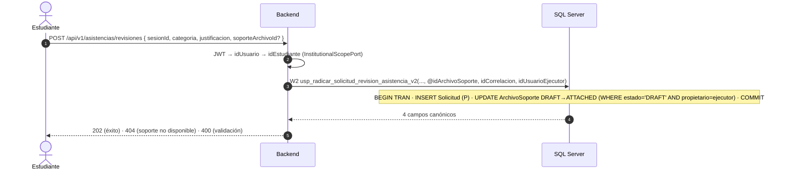
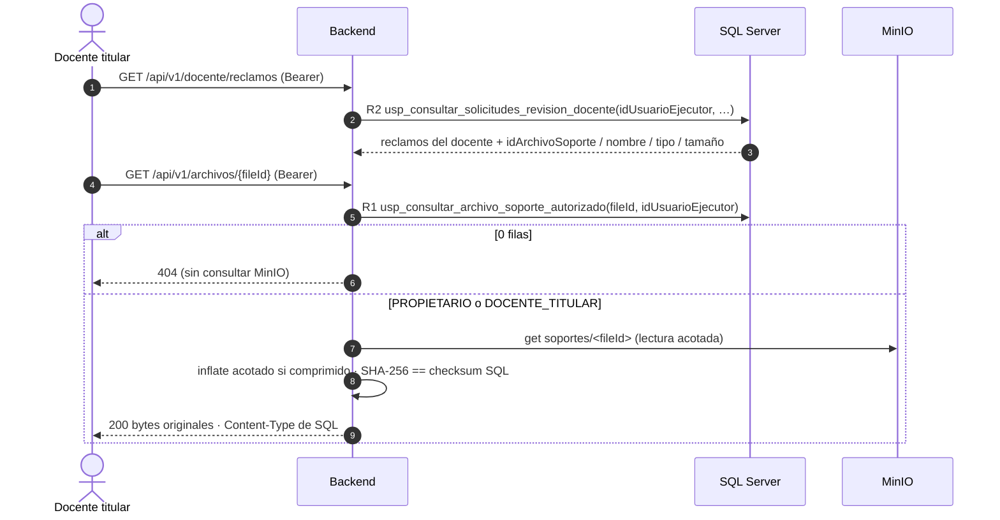
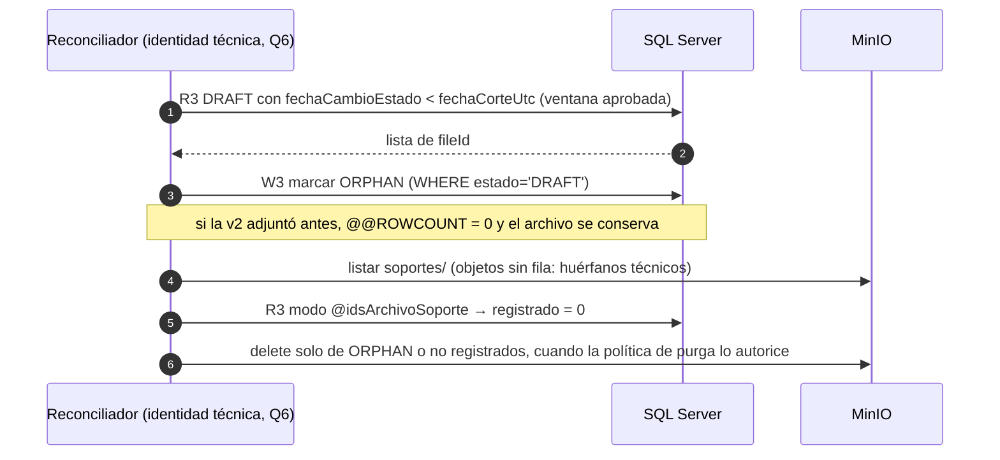

# LB-004D — Esquema de interacciones

MinIO **no** participa en ninguna transacción SQL. Cada flujo indica qué queda si falla en cada
punto y quién lo compensa. Objetos SQL según [CONTRACT_PROPOSAL](CONTRACT_PROPOSAL.md).

## 1. Subida del soporte (estudiante)

```mermaid
sequenceDiagram
    autonumber
    actor E as Estudiante (Angular)
    participant B as Backend
    participant C as ClamAV
    participant M as MinIO (privado)
    participant S as SQL Server
    E->>B: POST /api/v1/archivos/subir (Bearer, multipart)
    B->>B: JWT → idUsuario; extensión + MIME + magic; ≤ 5 MiB; nombre ≤ 250
    B->>C: INSTREAM
    C-->>B: CLEAN (INFECTED → 400; error/timeout → 500, fail closed)
    B->>B: compresión (si ahorra ≥ 10 %), SHA-256 de los bytes originales, fileId = UUID v4
    B->>M: put soportes/<fileId> + metadata técnica
    B->>S: W1 usp_registrar_archivo_soporte(fileId, nombre, tipo, tamanio, sha256, idCorrelacion, idUsuarioEjecutor)
    S-->>B: 4 campos canónicos (DRAFT)
    B-->>E: 201 { fileId, nombre, url relativa, tamanio }
```

| Falla | Estado resultante | Compensación |
|---|---|---|
| Validación o ClamAV | Nada escrito | — |
| `put` MinIO | Nada escrito | — |
| W1 responde `estadoResultado = 0` (rechazo definitivo) | Objeto sin fila | Backend `FileStoragePort.delete` best-effort; si falla, huérfano técnico → reconciliación (§4) |
| W1 con error de transporte o timeout (resultado desconocido) | Objeto con o sin fila | Backend reintenta W1 una vez con la **misma** correlación y metadata (idempotente). **No** borra los bytes sin conocer el resultado. Si sigue desconocido → 5xx y reconciliación |
| Respuesta HTTP perdida | `DRAFT` válido | El cliente reintenta la subida → nuevo `fileId`; el anterior acabará `ORPHAN` |

## 2. Radicación con soporte opcional (estudiante)



- MinIO no se toca: los bytes ya existen.
- Cualquier error → `ROLLBACK` completo; el archivo sigue `DRAFT` y puede reintentarse.
- Dos radicaciones simultáneas con el mismo `fileId`: solo una obtiene `@@ROWCOUNT = 1`; la otra
  hace `ROLLBACK` y recibe `ARC_001`.
- Reintento con la misma correlación tras un éxito: idempotente, sin segunda solicitud.

## 3. Consulta y descarga (docente titular o propietario)



- La autorización se resuelve en SQL **antes** de pedir bytes a MinIO.
- Checksum distinto o tamaño distinto → no se sirven bytes (5xx genérico, incidente de
  integridad registrado con correlación). El código HTTP exacto se fija en B1.
- Fila sin objeto en MinIO → igual tratamiento de integridad; el reconciliador puede marcarlo
  `SIN_BYTES` solo si estaba `DRAFT`. Un `ATTACHED` sin bytes es un incidente, nunca se oculta
  cambiando su estado.
- `owner-subject` de MinIO queda como control técnico adicional, no como autoridad.

## 4. Reconciliación (DIFERIDA — Q6; no implementada en D1)



- La edad del objeto MinIO nunca es la única autoridad.
- Sin ventana aprobada no hay `@fechaCorteUtc` y nada se marca.
- El diseño del worker (claim/lease, reintentos) es una microfase posterior (`STORAGE_LIFECYCLE`).
